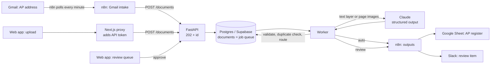

# Brightpan invoice & receipt extraction

Supplier invoices and receipts arrive by email or upload as digital PDFs, scans or phone photos. Each one is read
into structured data with line items, checked (line math, totals, duplicates) and filed in the accounts-payable
register. Documents that fail a check go to a review queue and a Slack message instead of the books.

Brightpan Kitchen Supply is a fictional store. Every vendor, document and number in `samples/` and `truth/` is
fictional and generated by `scripts/make_samples.py`.

## How it works



1. **Intake.** The web app uploads through a server-side proxy that adds the API token. n8n watches a dedicated Gmail
   address and posts each PDF/JPEG/PNG attachment. The API stores the file and returns `202` with an id at once.
2. **Read.** A worker claims queued documents from Postgres (`FOR UPDATE SKIP LOCKED`). A digital PDF sends its text
   layer; scans and photos are sent as page images. Claude returns the record through a structured-output schema,
   with a confidence per field.
3. **Check.** Pydantic validation, then plain code: required fields, `YYYY-MM-DD` dates, ISO 4217 currency,
   sum(line amounts) = subtotal and subtotal − discount + tax + shipping = printed total (within $0.02), and a
   duplicate check on vendor + invoice number. The extractor never corrects a document; it flags it.
4. **Route.** Any flag, or a required field read with less than 0.80 confidence, sends it to review. Clean documents
   become a row in the AP register. Review items post to Slack; approving one adds it to the register.
5. **Recover.** The worker survives database and API outages: rate limits, overload and network errors put the
   document back in the queue with backoff (3 attempts), documents left half-done by a stopped worker are requeued,
   and register rows or Slack messages that didn't go out are resent (the register row is keyed on the document ID,
   so a resend never adds a second row). `/health` reports the database and the worker.

## Test results

`eval/run_eval.py` uploads all 20 samples to the running system, scores every field against `truth/` and writes
`eval/results.csv`. The web app's Test results page is built from that file. Latest full run (2026-10-21, run
`20261021T110006Z`, on Supabase). Every mismatch was reviewed by hand; the verdicts are in
`eval/manual-review.md`. The case study for this project is in `docs/case-study.md`.

| Measure | Result |
| --- | --- |
| Header fields correct (vendor, number, dates, currency, PO, subtotal, tax, shipping, total) | 200/200 |
| Line items fully correct (description, quantity, unit price, amount) | 79/80 |
| Planted errors routed to review (INV10 wrong total, INV16 duplicate) | 2/2, correct flags |
| Clean documents wrongly sent to review | 0/18 |
| Invented values (receipt due dates, USD on CAD invoices) | 0 |
| Seconds per document, upload to finished | median 7.6, max 21.5 |
| Throughput (one worker) | 6.3 pages per minute |
| API cost per document | $0.025 mean, $0.51 for all 20 |
| Gmail intake | 3 emailed documents (a scan, a phone photo, a receipt) read and added to the AP register |

The one line-item miss is RCPT01: the receipt prints the description cut to 26 characters, the extractor reports
what is printed, and the answer key has the full name. On review it is kept as a miss (strict reporting). All 20 samples come from one generator with three invoice
layouts, so these numbers describe this test set, not every supplier's paperwork.

## Run it

Needs Python 3.12+ with [uv](https://docs.astral.sh/uv/), Node 20+, Docker, an Anthropic API key and a Postgres
database (a Supabase project's session pooler URL works).

```bash
cp .env.example .env              # ANTHROPIC_API_KEY, DATABASE_URL, API_TOKEN (see the comment in the file)
uv sync
ALLOW_RESET=1 uv run uvicorn app.main:app --port 8040   # API + worker; tables are created on startup

cd web && cp .env.example .env.local   # same API_TOKEN
npm install && npm run dev             # http://127.0.0.1:3040 (run `npx next typegen` before a bare `tsc`)

./n8n/run.sh                      # Demo 4's own n8n at http://localhost:5679
./n8n/deploy.sh                   # imports the workflows, attaches credentials, publishes them

uv run python eval/run_eval.py    # full eval (needs ALLOW_RESET=1 on the API; only removes earlier eval uploads)
uv run pytest -q                  # unit tests: validation, duplicate key, routing, worker, outputs, auth, scoring
TEST_DATABASE_URL=postgresql://… uv run pytest -q tests/test_duplicates_db.py   # duplicate SQL on a throwaway schema
```

n8n needs a Google Sheets OAuth2 credential (AP register) and a Gmail OAuth2 credential (intake). Set
`SLACK_WEBHOOK_URL`, `AP_REGISTER_SHEET_URL`, `GMAIL_INTAKE_ADDRESS` and `OUTPUTS_WEBHOOK_SECRET` in `.env`.
`run.sh` passes only the values n8n needs into the container; `deploy.sh` creates the outputs webhook's Header Auth
credential from the secret and won't publish the Gmail intake until its address is set.

## Adding a field

Say accounts payable also wants the vendor's tax ID:

1. `app/models.py`: add `vendor_tax_id: str | None` to `Extraction`, `Confidence` and `Record`.
2. `app/extract.py`: add one line to the prompt saying where it is printed and that it is null when absent.
3. `app/validate.py`: if it is required, add it to `REQUIRED_FIELDS` in `models.py`; add any format check to
   `missing_required`.
4. `app/notify.py`: add a column to `sheet_row`, and the same header to the AP register sheet.
5. `truth/*.json` and `eval/scoring.py` (`HEADER_FIELDS`), so the eval measures it; then rerun the eval.
6. `web/src/lib/api.ts` and `web/src/components/document-view.tsx` to show it.

## Known limits

- **No user accounts.** The API requires a bearer token and the web app only accepts same-origin requests on
  127.0.0.1, but there is no login, so the review queue doesn't record who approved an item. Before anyone else uses
  it: add authentication to the web app and store the reviewer on `review_queue`.
- **Confidence is the model's own estimate.** It catches unreadable fields but is not calibrated; the line math and
  duplicate checks are what catch wrong numbers.
- **Duplicates need both vendor and invoice number readable**, and are matched after removing case, spaces and
  punctuation. The same invoice from a vendor whose name is written differently ("Ferro Metalworks" vs "Ferro
  Metal Works Inc.") would not be caught.
- **One worker.** Documents are processed one at a time in arrival order, which keeps the duplicate check exact.
  Running several workers in parallel would need a uniqueness constraint or lock on the duplicate key.
- **Receipts:** when a receipt prints only quantity and amount, the unit price is amount ÷ quantity.
- **PDFs with a scanner's OCR layer** are read from that text layer, not the page image, because any PDF with text
  on every page counts as digital. Poor OCR text would lower accuracy; none of the test scans has an OCR layer.
- **Cost of a server-side fallback** (a different model answering after a refusal) is priced at the answering
  model's rate for the whole response. Calls that fail are recorded with their cost when the API reports usage.
- **Limits:** 20 MB per file, 20 pages per PDF; longer documents are refused and should be entered by hand.
- **Small test set:** 20 synthetic documents in three layouts.
